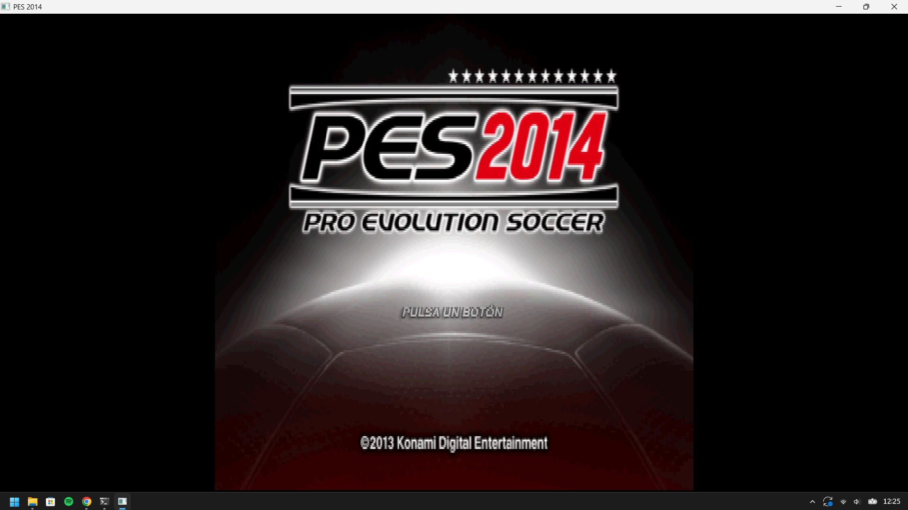
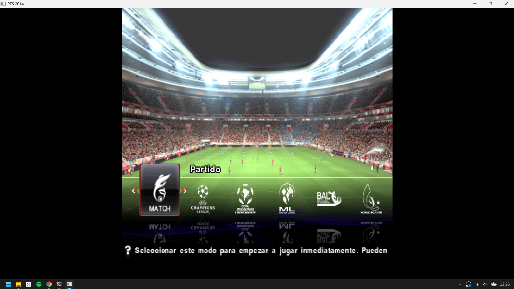
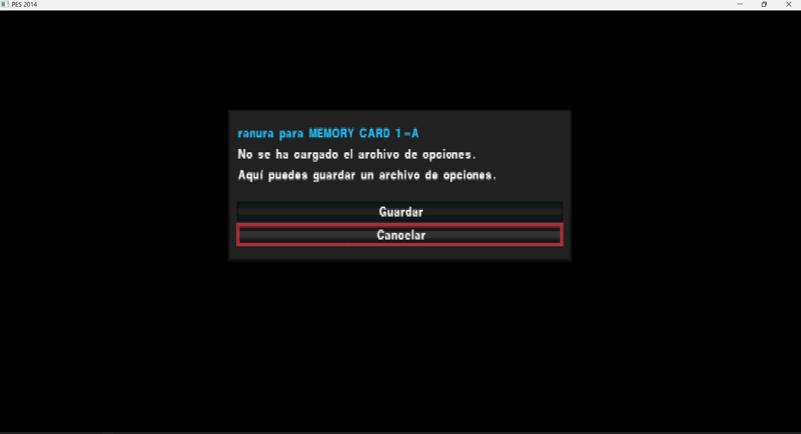

# PES 2014 (PS2) — Native Recompilation Progress

Static recompilation of **Pro Evolution Soccer 2014** (PAL, `SLES_556.76`) to native Windows
(x86-64) using the **PS2Recomp** toolchain, plus the runtime fixes needed to make it actually
run and render.

> Status: **boots, plays menus/stadium in full colour, reaches the match state machine.
> The match itself still renders black.** Details, evidence and open problems are documented
> here so others can help.

---

## Choose your language / Escolha o idioma / Elige el idioma

| Language | Document |
|---|---|
| 🇧🇷 Português | [`pt-BR.md`](pt-BR.md) |
| 🇺🇸 English | [`en.md`](en.md) |
| 🇪🇸 Español | [`es.md`](es.md) |
| 🔧 Technical notes (code level) | [`TECHNICAL-NOTES.md`](TECHNICAL-NOTES.md) |

---

## One-paragraph summary (all languages)

The game is fully recompiled (~63k functions) and boots. Rendering was broken by a
**VIF1 streaming bug** (UNPACK packets that straddle DMA tags were silently dropped, so every
vertex colour arrived as zero) and by a **GS CSR `FINISH` bit that was never raised** (the EE
spun forever in a `sceGsSyncPath`-style wait loop). Both are fixed. On top of that, a missing
overlay (`training_free.ovl`) was recompiled and the overlay entry-point discovery was improved.
`missing-target` errors went to zero and `XGKICK aborted` fell from **130 048 to 128**.
Menus, stadium, crowd and pitch now render in full colour. The remaining blocker is the
match's vertex pipeline: the geometry submitted during the match is degenerate
(`x=0..2048`, `y=2048..2048`) and its colour is `0`, so the screen stays black.

## Nutshell (PT-BR)

O jogo foi recompilado por completo e inicia. A renderização estava quebrada por um **bug de
stream do VIF1** (pacotes UNPACK que atravessavam tags DMA eram descartados, fazendo toda cor
de vértice chegar como zero) e por um **bit `FINISH` do CSR do GS que nunca era setado** (a EE
ficava presa num laço de espera estilo `sceGsSyncPath`). Ambos corrigidos. Além disso,
recompilei o overlay que faltava (`training_free.ovl`) e melhorei a descoberta de entry points
dos overlays. Os erros `missing-target` foram a zero e `XGKICK aborted` caiu de **130.048 para
128**. Menus, estádio, torcida e gramado agora aparecem em cores. O bloqueio restante é o
pipeline de vértices da partida: a geometria enviada é degenerada (`x=0..2048`,
`y=2048..2048`) e a cor é `0`, então a tela fica preta.

## En una frase (ES)

El juego está recompilado por completo y arranca. El renderizado estaba roto por un **bug de
streaming del VIF1** (los paquetes UNPACK que cruzaban tags DMA se descartaban, así que el color
de cada vértice llegaba como cero) y por un **bit `FINISH` del CSR del GS que nunca se ponía**
(la EE quedaba atrapada en un bucle de espera tipo `sceGsSyncPath`). Ambos corregidos. Además
recompilé el overlay que faltaba (`training_free.ovl`) y mejoré el descubrimiento de entry
points. `missing-target` llegó a cero y `XGKICK aborted` bajó de **130 048 a 128**. Menús,
estadio, público y césped ya se renderizan en color. El bloqueo restante es el pipeline de
vértices del partido: la geometría es degenerada (`x=0..2048`, `y=2048..2048`) y el color es
`0`, por eso la pantalla queda negra.

---

## Screenshots

| Title screen | Mode select over the 3D stadium |
|---|---|
|  |  |

| Message box / memory-card dialog |
|---|
|  |

These three captures come from the **native recompiled build** (`PES2014-Recompiled.exe`), not
from an emulator. They demonstrate that text/font rendering, the logo, the 3D stadium, the
crowd, the pitch and the menu layer all work. The match scene itself is still black — see
**“What is still broken”** in the language guides.

---

## How this was made / Como foi feito / Cómo se hizo

> **All of the debugging, instrumentation, runtime patches, overlay recompilation and this
> documentation were produced with an AI coding agent** (OpenCode running a large language
> model), working interactively with the repository owner, who ran the game, captured
> screenshots and supplied the PCSX2 reference dump.
>
> **Todo o trabalho de depuração, instrumentação, correções de runtime, recompilação de
> overlays e esta documentação foi produzido com um agente de IA** (OpenCode com um modelo de
> linguagem), de forma interativa com o dono do repositório, que executou o jogo, capturou as
> telas e forneceu o dump de referência do PCSX2.
>
> **Todo el trabajo de depuración, instrumentación, parches de runtime, recompilación de
> overlays y esta documentación fue producido con un agente de IA** (OpenCode con un modelo de
> lenguaje), de forma interactiva con el dueño del repositorio, que ejecutó el juego, capturó
> las pantallas y aportó el dump de referencia de PCSX2.

The AI agent did **not** invent the architecture: it used the existing PS2Recomp toolchain
(`ps2xAnalyzer`, `ps2_recomp`, `ps2xRuntime`, the overlay scripts) and the PCSX2 emulator as
ground truth. Every claim in these documents is backed by a log line, a measured counter or a
comparison against the PCSX2 GS dump.

---

## Quick facts / Dados rápidos

| Item | Value |
|---|---|
| Game | PES 2014 — Pro Evolution Soccer (Europe) (Es,Pt) |
| Serial | `SLES_556.76` (PAL) |
| Toolchain | [PS2Recomp](https://github.com/ran-j/PS2Recomp) (`ps2xAnalyzer`, `ps2xRecomp`, `ps2xRuntime`) |
| Host | Windows x86-64, MSVC / CMake |
| Recompiled functions | ~63k generated translation units |
| Overlays recompiled | 13 (`16,18,19,20,21,29,30,31,34,37,40,41,137`) |
| Graphics backend | CPU GS rasteriser (`ps2xRuntime/src/lib/gs/gs_cpu_backend.cpp`) |
| Reference emulator | PCSX2 2.x + GS dump (`.gs.zst`) |

## Contents of this folder

```
docs/
├── README.md              ← you are here
├── pt-BR.md               ← complete guide (Portuguese)
├── en.md                  ← complete guide (English)
├── es.md                  ← complete guide (Spanish)
├── TECHNICAL-NOTES.md     ← code-level notes, patches, evidence
├── POSTING-ON-GITHUB.md   ← how to publish this report (templates, labels, .gitignore)
├── images/
│   ├── 01-memory-card-dialog.png
│   ├── 02-title-screen.png
│   └── 03-match-menu-stadium.png
└── patches/
    └── README.md          ← changed files + abridged diffs
```

## Ready-to-run package / Pacote pronto para rodar / Paquete listo

`dist/` (next to this `docs/` folder) is a self-contained build:

```
dist/
├── PES2014-Recompiled.exe   (~672 MB, native x86-64)
├── *.dll                    SDL2, FFmpeg, VC++ runtime (app-local)
├── run.cmd                  launcher (uses relative paths)
├── LEIA-ME.txt              run/status/legal notes (PT + EN)
├── disc/                    extracted game data — NOT redistributable
└── docs/                    this documentation
```

Just run **`run.cmd`**. The `disc/` folder is the game data and must not be published on
GitHub; share only the documentation, the sources and the patches.

---

## How to contribute

0. If you want to **build and test**, start with the environment check in the share pack:
   `powershell -ExecutionPolicy Bypass -File .\CHECK.ps1` (read-only, exits non-zero when
   something is missing). Full steps in `share/SETUP.md`.
1. Read the language guide that suits you.
2. Read `TECHNICAL-NOTES.md` for the exact files/lines.
3. The open problem is described in **“What is still broken”** — repro steps and the
   diagnostics needed are listed there.
4. If you have a working PCSX2 + a GS dump of the first match seconds, that reference is
   extremely valuable (see the *Reference data* section).

## License / credits

The recompiler, runtime and tooling belong to their respective authors (PS2Recomp project,
PCSX2 dev team for the emulator and the GS memory model references). This document only
records the debugging work done on top of them. No game data is distributed here.
