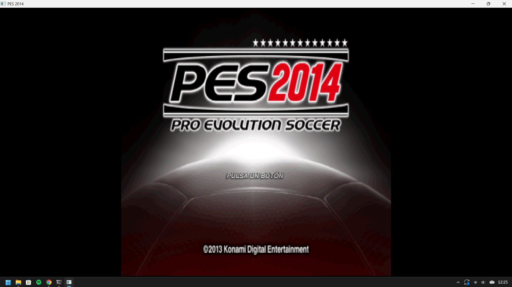
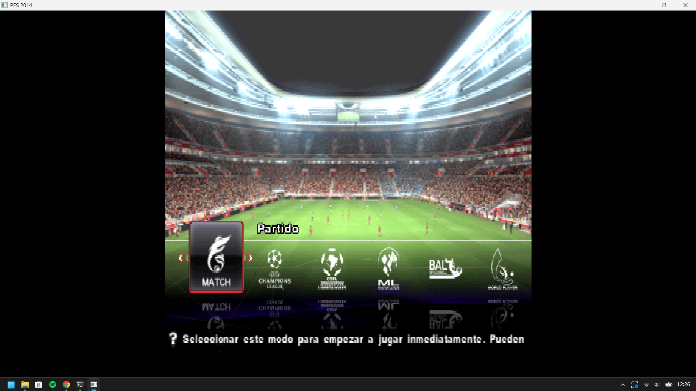
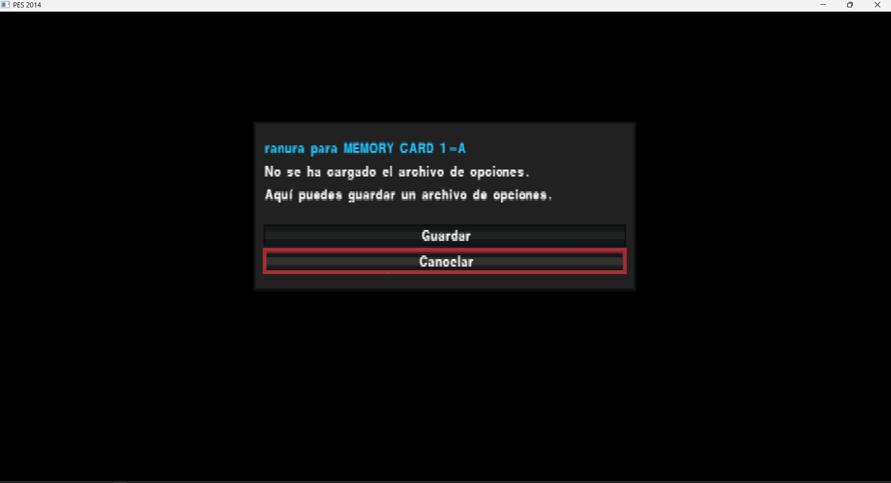

# PES 2014 (PS2) — Native Recompilation: Full Guide (EN)

> Static recompilation of **Pro Evolution Soccer 2014** (PAL, `SLES_556.76`) to native
> Windows x86-64 with **PS2Recomp**, plus the runtime fixes required to make it run and
> render.

**One-line summary:** the game boots and the menus/stadium/crowd/pitch render in full colour;
the match reaches the point of loading `game.ovl` **without crashing**, but the match scene
still renders black because the submitted geometry is degenerate and colourless.

---

## 1. Current status

### ✅ Works

| Item | Evidence |
|---|---|
| Full boot (BIOS → ELF → IOP) | `[PES boot] thread ...`, `[ps2xIOP] [PES IOP running]` |
| Title screen, menus, team select, badges/flags | PNG frames with real content (96–165 KB) |
| 3D stadium, crowd, pitch, players on the field | same, with correct textures and CLUT |
| Game state machine up to the match | `[PES scene] ... game=10 step=5` |
| Overlay loading | `[PES overlay] bootset/title/select/enter/game/training_free.ovl` |
| No missing functions | `missing-target` counter = **0** |
| Healthy XGKICK path | `aborted` dropped from **130 048** to **128** |

### ❌ Still broken

| Item | Measured symptom |
|---|---|
| Match scene | black screen (`fbp=128` never receives the blit) |
| Match geometry | degenerate draws: `x=0..2048`, `y=2048..2048` (zero area) |
| Match colour | `rgb=0-0/0-0/0-0`, `alpha=0,0` most of the time |
| Scene framebuffer (`fbp=0`) | uniformly `0x80` (grey) — that is the *clear*, not the scene |

---

### 📷 Screenshots (native build, not an emulator)

| Title screen | Mode select over the 3D stadium |
|---|---|
|  |  |

| Message box / memory-card dialog |
|---|
|  |

> **Made with AI.** Everything described here — debugging, instrumentation, runtime patches,
> overlay recompilation and this documentation — was produced by an **AI coding agent**
> (OpenCode running a large language model) in an interactive session with the repository
> owner, who ran the game, captured the screenshots and supplied the PCSX2 reference dump.

---

## 2. Architecture

```
SLES_556.76 (main ELF)
        │
        ├─ ps2xAnalyzer  (Ghidra + embedded SCE symbol database)
        │        └─ functions.csv  +  analyzer.toml
        │
        ├─ ps2_recomp    (TOML → C++)
        │        ├─ pes2014.toml .......... main ELF
        │        └─ ranges/overlays/NN.toml ... one per .ovl
        │                 └─ output/ or code-NN/  (*.cpp, register_functions.cpp)
        │
        ├─ stage-overlays.py  → stages code-NN into the runner
        │        └─ ps2xRuntime/src/runner/pes_overlay_*.cpp
        │           ps2xRuntime/src/runner/pes_overlay_dispatch.cpp
        │
        └─ CMake (ps2EntryRunner) → PES2014-Recompiled.exe
```

Relevant runtime files:

- `ps2xRuntime/src/lib/ps2_vif1_interpreter.cpp` — VIF1 (UNPACK, DIRECT, MPG, MSCAL)
- `ps2xRuntime/src/lib/vu/ps2_vu1_core.cpp` — VU1 interpreter (XGKICK, MSCAL/MSCNT)
- `ps2xRuntime/src/lib/vu/ps2_vu1_lower.cpp` — VU1 *lower* instructions (LQ/SQ/JR/…)
- `ps2xRuntime/src/lib/gs/ps2_gif_arbiter.cpp` — GIF path ordering
- `ps2xRuntime/src/lib/gs/gs_frontend.cpp` — GIF/GS packet decoding
- `ps2xRuntime/src/lib/gs/gs_cpu_backend.cpp` — CPU GS rasteriser
- `ps2xRuntime/src/lib/gs/ps2_gs_memory.cpp` — GS memory model (swizzle)
- `ps2xRuntime/src/lib/ps2_memory.cpp` — registers, CSR, DMA, VIF
- `ps2xRuntime/src/lib/Kernel/EeScheduler.cpp` — threads/semaphores/VSync
- `ps2xRuntime/src/runner/pes_overlay_dispatch.cpp` — overlay dispatch

---

## 3. What was done, in order

### Phase 1 — Initial diagnosis

1. The build already produced a working `.exe` (~63k functions) but the 3D scene was black;
   it only appeared with `PES2014_FORCE_RGBA=255,255,255,255`.
2. Runtime instrumentation was added for: VU input, SQ/RGBAQ, XGKICK, CLUT/textures, VRAM,
   draws, disc queue and the game scene state machine.
3. A **ground-truth reference** was captured from PCSX2 (a GS dump of the same match) to
   compare against the runtime.

### Phase 2 — Rendering proofs

- The **CLUT is correct**: applying the runtime's mapping to the reference VRAM yields a
  monotonic palette (`alpha` 01,07,0d,15,1b,21…) — coherent. The old CLUT trace was
  misleading (it sampled the first 6 draws, before the real upload).
- **`vf01`** (the colour ceiling used by `mini.xyzw vf05, vf05, vf01`) is **correct**:
  `(128,128,128,255)`.
- Disassembling the VU1 microprogram (`vudecode.py` from Crash-Twinsanity) confirmed the
  `RGBAQ` slot comes from `lq.xyzw vf05, 2(vi04)` → `maxx` → `mini` → `ftoi0` → `sq`.
  So **the colour is read ready-made from memory**; it is not a VU math bug.

### Phase 3 — Root cause #1: VIF1 dropped UNPACKs (stream vs DMA)

Symptom:

```
[PES VIF trunc] op=6c imm=eaa1 num=70 vl=0 vn=3 ... vuAddr=2a1 bytes=1120 avail=796
```

The interpreter processed **each DMA block in isolation**. When an UNPACK payload straddled a
DMA tag boundary (VIF is a byte stream), the whole unpack was silently discarded — including
vertex records and colours.

Fix (in `ps2_vif1_interpreter.cpp`):

- Persistent buffer `m_vif1Stream` + `m_vif1StreamPos`.
- On an incomplete command, **rewind to the command start** (`pos = cmdStart`) and resume on
  the next call instead of dropping the data.
- Same treatment for `DIRECT/DIRECTHL`, `MPG`, `STMASK`, `STROW`, `STCOL`.
- Compact the buffer only every 64 KiB (avoids O(n) per call).

Result: menus/stadium started rendering **in colour**; `XGKICK aborted` fell from
**130 048 → 128**.

### Phase 4 — Root cause #2: CSR `FINISH` never raised

The game froze exactly at the menu→match transition, with `draws` frozen. The main thread was
spinning in:

```
0x1018EC: ld   r3, 0(0x12001000)   ; GS CSR
0x1018F8: andi r3, r3, 0x2         ; bit 1 = FINISH
0x1018FC: bne  r3, r0, 0x101938    ; wait for FINISH
```

Our GS backend is **synchronous** (renders immediately), so the GS is always “finished”, but
the bit was never raised on reads.

Fix (in `ps2_memory.cpp`): CSR reads OR in `kGsCsrFinishBit` (bit 1). The EE can still clear
it via write-1-to-clear.

Result: the game advanced to `game=10` (the match).

### Phase 5 — Overlay recompilation (done in this session)

Logs showed that, at the failure point, the overlay resident at `0x93A880` was
**`training_free.ovl`**, and that overlay **had not been recompiled**:

```
[PES overlay] 0x93a880 resident=training_free.ovl bytes=27bdfff0 ffbf0000 c097a08 0
              pc=0x966e20
```

Steps performed:

1. Built the recompiler: CMake target **`ps2_recomp`** →
   `ps2-build/ps2xRecomp/Release/ps2_recomp.exe`.
2. `ranges/recompile-overlays.py ... 34` → `training_free.ovl`:
   **244 functions**, 569 entry points initially.
3. **Pipeline improvement:** the script only harvested references from the main ELF + the
   overlay itself, missing **cross-overlay** calls (e.g. `select.ovl → training_free.ovl`).
   It now scans **all** `*.ovl.elf` files:
   - entry points: **569 → 4,025**
   - `0x959A70` (the missing target) became present in the dispatch table.
4. `ranges/stage-overlays.py` regenerated the dispatcher and runner batches.
5. Reconfigured CMake (the build globs sources) and rebuilt.

Result: **`missing-target` = 0**; the game no longer dies at the transition.

### Phase 6 — What is left

Even without the crash, the match is **black**: scene draws are degenerate and colourless
(`x=0..2048`, `y=2048..2048`, `rgb=0-0`). That is the next target (see §9).

---

## 4. Runtime bugs fixed along the way

| # | File | Symptom | Fix |
|---|---|---|---|
| 1 | `ps2_vif1_interpreter.cpp` | UNPACK cut across DMA tags was dropped | **stream** consumption with rewind to the command |
| 2 | `ps2_memory.cpp` | CSR `FINISH` never set → infinite loop | CSR reads OR in bit 1 |
| 3 | `vu/ps2_vu1_lower.cpp` | `JR/JALR` used a stale VI backup (upstream PR #418) | JR/JALR read the **current VI**; backup only for conditional branches |
| 4 | `gs/ps2_gif_arbiter.cpp` | UB comparator reordered Path1 before Path3 | **FIFO** drain |
| 5 | `vu/ps2_vu1_core.cpp` | host rounding not restored before GS submit (PR #422) | restore rounding around submit |
| 6 | `ps2_vif1_interpreter.cpp` | `MPG` without address wrap (PR #437) | `uploadMicroMemory` with wrap |
| 7 | `vu/ps2_vu1_core.cpp` | invalid XGKICK killed the VU | cancel only the transfer; cap packet at 16 KB |
| 8 | `vu/ps2_vu1_core.cpp` | `MSCNT` restarted at the wrong address | resume at the address latched by MSCAL |
| 9 | `ps2_vif1_interpreter.cpp` | `STMASK` consumed 4 bytes (12-byte desync) | consume **one qword** |

---

## 5. Overlays: how they work and why they matter

Several game overlays share the **same load base** (`0x93A880`):

| # | File | Real extent (ELF) |
|---|---|---|
| 29 | `enter.ovl` | 0x93A880–0x97AE80 |
| 30 | `title.ovl` | 0x93A880–0x947A80 |
| 31 | `bootset.ovl` | 0x93A880–0x940480 |
| 32 | `result.ovl` | 0x93A880–0x99C900 |
| 33 | `ending.ovl` | 0x93A880–0x94EA80 |
| 34 | `training_free.ovl` | 0x93A880–0x972E80 |
| 35 | `mc_conv.ovl` | 0x93A880–0x93F500 |
| 36 | `fantasista2.ovl` | 0x93A880–0x98FD80 |

Because the game swaps overlays at runtime, the runtime identifies **which one is resident**
via a 16-byte *fingerprint* at `base + 0x80` and only dispatches when it matches.

> ⚠️ Practical consequence: an address such as `0x966E20` belongs to **enter** and
> **training_free** at the same time. The fingerprint decides. That is exactly what revealed
> the missing overlay.

### Measured recompilation coverage

| Overlay | Not recompiled (approx.) |
|---|---|
| `41 defaultdataset` | 99.4 % |
| `21 fantasista_work` | 97.9 % |
| `40 select` | 57.6 % |
| `18 select1` | 26.5 % |
| `31 bootset` | 22.6 % |
| `19 formation` | 15.0 % |
| `29 enter` | 14.2 % |
| `16 memorycard` | 12.3 % |
| `30 title` | 7.9 % |
| `20 league_prog` | 7.8 % |
| `37 game` | 6.5 % (~250 KB) |

> Part of these “gaps” is **data/BSS**, not code. To decide, compare the maximum entry point
> with the end of the code segment in the ELF.

---

## 6. How to build

Requirements: Windows, Visual Studio 2022 (MSVC x64), CMake ≥ 3.25, Python 3.

> **Before anything else**, run the environment check from the share pack:
> `powershell -ExecutionPolicy Bypass -File .\CHECK.ps1`
> It validates the toolchain, the `disc/` layout, the repository commit and free disk space
> (read-only; exits with code 0 when everything is ready). See `share/SETUP.md`.

```powershell
# 1) configure
$src = "<repo>\.local\PS2Recomp"
$bld = "<repo>\.local\ps2-build"
$gen = "<repo>\.local\pes2014\ranges\output"
cmake -S $src -B $bld "-DPES2014_GENERATED_DIR=$gen" -DFETCHCONTENT_UPDATES_DISCONNECTED=ON

# 2) build the runner (final exe)
cmake --build $bld --config Release --target ps2EntryRunner --parallel 4
#    output: $bld\ps2xRuntime\Release\PES2014-Recompiled.exe

# 3) (optional) the recompiler, if you need to regenerate code
cmake --build $bld --config Release --target ps2_recomp --parallel 4
```

> **Important:** CMake *globs* the runner sources. After generating/removing
> `pes_overlay_*.cpp` files you **must reconfigure** (`cmake -S ... -B ...`) before building,
> otherwise you get unresolved symbols (`LNK2001`).

## 7. How to run

```powershell
# from the folder containing the exe + DLLs (dist) and the disc\ folder
$env:PES2014_BOOT_DIAGNOSTICS = '1'   # enables almost all traces
$env:PES2014_TEST_INPUT       = '1'   # automatic navigation (alternating Start/Cross)
& ".\PES2014-Recompiled.exe"
```

The exe needs the `disc\` folder next to it (or a configured path) containing `SLES_556.76`,
`SYSTEM.CNF`, `IOP\` and the `*.AFS` archives.

---

## 8. Diagnostic environment variables

| Variable | Effect |
|---|---|
| `PES2014_BOOT_DIAGNOSTICS` | **prerequisite** for most traces; periodic thread/semaphore/VRAM/draw dumps |
| `PES2014_TEST_INPUT` | automatic input (Start/Cross every ~90 frames) |
| `PES2014_TEST_FAST_INPUT` | same, period 34 |
| `PES2014_GS_FRAME=n` | detailed draw dump of frame `n` |
| `PES2014_GS_FRAME_SPAN=k` | window of `k` frames from `n` |
| `PES2014_TEX_DUMP` | print texture/CLUT parameters |
| `PES2014_DUMP_VRAM` | write `boot-vram-<frame>.bin` (4 MiB) |
| `PES2014_VU_INPUT` | dump VIs and memory read at XGKICK |
| `PES2014_VU_PATH` | VU1 path/input trace |
| `PES2014_SQ_TRACE` | trace `SQ` writes into RGBAQ |
| `PES2014_DUMP_VU` | write `vu-code.bin` / `vu-data-*.bin` |
| `PES2014_VU_LOWTRACE` | UNPACKs landing at low addresses |
| `PES2014_XGKICK_TRACE` | trace emitted XGKICKs |
| `PES2014_GIF_PATH` | per-GIF-path trace |
| `PES2014_FORCE_RGBA=r,g,b,a` | force vertex colour at GS (pipeline proof) |
| `PES2014_FORCE_ALPHA=a` | force alpha |
| `PES2014_VU_COLOR_FALLBACK` | replace zero RGB with 128 at SQ (workaround) |
| `PES2014_VIF_TRUNC` | log UNPACKs that arrive incomplete |
| `PES2014_SEMA_TRACE` | semaphore trace (create/signal/Wait) |
| `PES2014_FILE_TRACE` | file trace (VFS and IOP host) |

---

## 9. What is still broken (the open problem)

### Symptom

In the match (`game=10`) the screen is black. Submitted draws are degenerate and colourless:

```
[PES GS draw] fbp=0 prim=4 iip=1 abe=1 x=0,2048 y=2048,2048
              textured=1 tex=8224 tpsm=20 clut=15936/0/0/0 alpha=0,0 rgb=0-0/0-0/0-0
```

`XYOFFSET = 0x7000` (28672 = 2048 in 12.4): a position of `0` becomes `2048`. So vertices are
arriving **zeroed** at the VU/GS on this path.

### Already ruled out

- CLUT: correct (validated against the PCSX2 dump).
- `vf01`: correct `(128,128,128,255)`.
- GS 2D/blit pipeline: works (menus render with the same `fbp=0 → 128` blit).
- Overlays: all required ones load; `missing-target` = 0.

### Hypotheses to investigate

1. **Match vertex records**: the VU reads `lq.xyzw vf05, 2(vi04)`. Earlier samples had
   `q2` (colour) = `0` while `q0` (position) held valid floats — but the final draws are all
   zero. Compare the **UNPACK that writes `vi04..vi04+3`** with what the VU reads at the same
   instant (`PES2014_VU_LOWTRACE` + `PES2014_VU_INPUT`).
2. **TOPS double buffering**: producer writing to `0x2xx` while the consumer reads `0x0xx`
   (or vice versa) means the data never meets.
3. **Second VU path** (`0x1F0`/`0x3F0`): check whether the program that writes colours
   (`sq.xyzw vf01, 2(vi04)` / `sq.xyzw vf07, 2(vi01)`) is actually executed.
4. **Final blit**: confirm the `prim=6, tme=1, fb=128` sprites are still emitted in the match
   (not only degenerate `prim=4`).

### How to reproduce

```powershell
$env:PES2014_BOOT_DIAGNOSTICS='1'
$env:PES2014_TEST_INPUT='1'
$env:PES2014_GS_FRAME='9000'
$env:PES2014_VU_INPUT='1'
$env:PES2014_VU_LOWTRACE='1'
$env:PES2014_SQ_TRACE='1'
.\PES2014-Recompiled.exe
# compare boot-frame-9000.png with the PCSX2 frame
```

---

## 10. Reference data (PCSX2)

- Captured dump: `Pro Evolution Soccer 2014_SLES-55676_20261111200920.gs.zst` (2 MB)
- Decompressed: 11,169,623 bytes; 1,636 transfers (all `path=3`); `state_version=9`.
- Dump layout: `[0xFFFFFFFF][header][state][regs 0x2000][id 0/1/2/3 ...]`.
- Reference scene packet `tag=3000000000008004` (NLOOP=4, NREG=3, ST/RGBAQ/XYZF2):

```
RGBAQ  r=128 g=124 b=128 a=128
ST     s≈0.0030 t=0.0000 q≈0.0015
XYZF2  x=44165 y=12437 z=0x12c4 f=250
```

- Reference CLUT at `cbp=16212`: `3cffffff 47ffffff 3c777777 478d8d8d 51ffffff …`
  (increasing alpha — a valid palette).
- Reference `TEX0_1`: `tbp=15200 tbw=2 psm=19 cbp=16312 cpsm=0 csm=0 csa=1`.

---

## 11. Project tools and scripts

| Path | Purpose |
|---|---|
| `ranges/export-overlays.py` | extracts `.ovl` from the AFS, writes ELFs + `overlays.json` |
| `ranges/recompile-overlays.py` | generates `NN.toml` (automatic entry points) and runs the recompiler |
| `ranges/stage-overlays.py` | stages `code-NN` into the runner and regenerates the dispatcher |
| `ranges/collect-overlay-imports.py` | collects imports/relocations |
| `ranges/test-boot.ps1` | runs the game for N seconds, saves logs/PNGs |
| `ranges/rebuild-test.ps1` | build + smoke test |
| `build-prototype.ps1` | batches + CMake + build |
| `tools/` | capstone, pyelftools (analysis) |

---

## 12. How to help

1. **Reproduce** the current state with the commands above and confirm the numbers
   (`missing-target=0`, `XGKICK aborted≈128`).
2. **Attack the open problem** (§9). The most efficient step today is a frame-by-frame
   comparison of the packets our VU1 produces against the PCSX2 dump.
3. **Send references**: if you have PCSX2 + a BIOS, a GS dump of the **first seconds of the
   match** (kick-off, gameplay camera) is extremely valuable.
4. **Recompile missing overlays** with the pipeline in §11 (`recompile-overlays.py` already
   scans every overlay).

---

## Appendix — session numbers

| Metric | Before | After |
|---|---|---|
| `missing-target` | 1 (thread died at `pc=0x1`) | **0** |
| `XGKICK aborted` | 130,048 | **128** |
| `draws` (frame 8640) | frozen at 417,051 | 409,071+ (no crash) |
| Overlays recompiled | 12 | **13** (+`training_free`) |
| `training_free` entry points | — | 4,025 |
| `training_free` functions | — | 244 |
