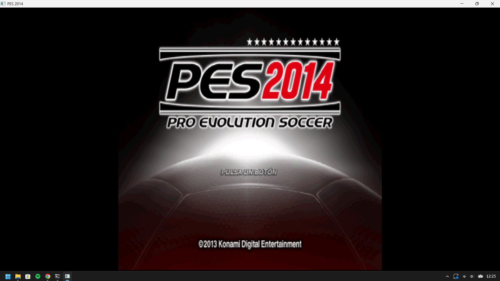
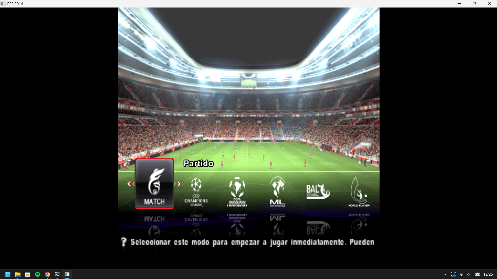
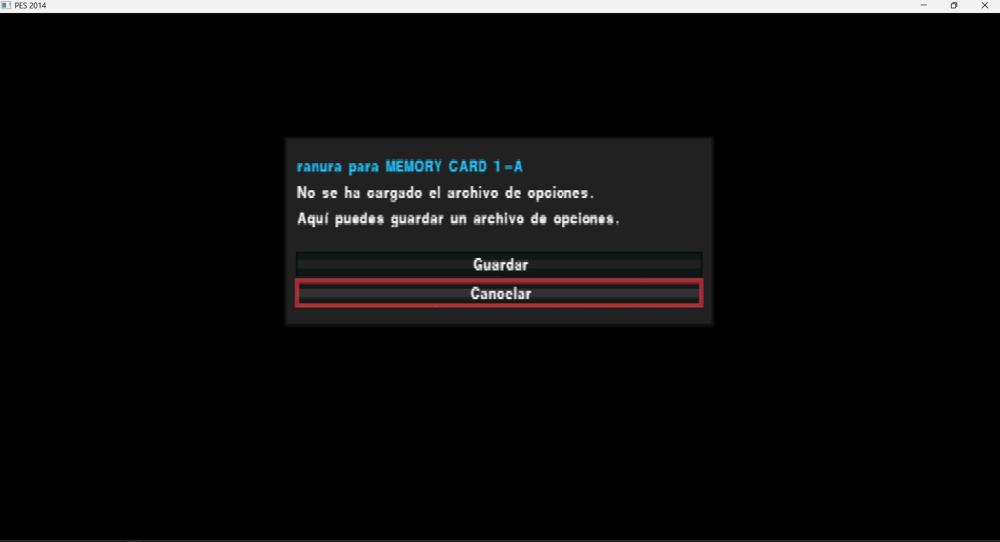

# PES 2014 (PS2) — Recompilación Nativa: Guía Completa (ES)

> Recompilación estática de **Pro Evolution Soccer 2014** (PAL, `SLES_556.76`) para Windows
> x86-64 con **PS2Recomp**, más las correcciones de runtime necesarias para que el juego
> arranque y renderice.

**Resumen en una línea:** el juego arranca y los menús/estadio/público/césped se renderizan
en color; el partido llega a cargar `game.ovl` **sin colgarse**, pero la escena del partido
todavía sale negra porque la geometría enviada es degenerada y sin color.

---

## 1. Estado actual

### ✅ Funciona

| Elemento | Evidencia |
|---|---|
| Arranque completo (BIOS → ELF → IOP) | `[PES boot] thread ...`, `[ps2xIOP] [PES IOP running]` |
| Pantalla de título, menús, selección de equipo, escudos/banderas | frames PNG con contenido real (96–165 KB) |
| Estadio 3D, público, césped, jugadores | idem, con texturas y CLUT correctas |
| Máquina de estados hasta el partido | `[PES scene] ... game=10 step=5` |
| Carga de overlays | `[PES overlay] bootset/title/select/enter/game/training_free.ovl` |
| Sin funciones perdidas | contador `missing-target` = **0** |
| XGKICK sano | `aborted` bajó de **130 048** a **128** |

### ❌ Todavía no funciona

| Elemento | Síntoma medido |
|---|---|
| Escena del partido | pantalla negra (`fbp=128` nunca recibe el blit) |
| Geometría del partido | draws degenerados: `x=0..2048`, `y=2048..2048` |
| Color del partido | `rgb=0-0/0-0/0-0`, `alpha=0,0` |
| Framebuffer de escena (`fbp=0`) | uniforme `0x80` (gris) — es el *clear*, no la escena |

---

### 📷 Capturas (build nativa, no es un emulador)

| Pantalla de título | Selección de modo con estadio 3D |
|---|---|
|  |  |

| Cuadro de diálogo / tarjeta de memoria |
|---|
|  |

> **Hecho con IA.** Todo lo descrito aquí — depuración, instrumentación, parches de runtime,
> recompilación de overlays y esta documentación — fue producido por un **agente de IA**
> (OpenCode con un modelo de lenguaje), en sesión interactiva con el dueño del repositorio,
> que ejecutó el juego, capturó las pantallas y aportó el dump de referencia de PCSX2.

---

## 2. Arquitectura

```
SLES_556.76 (ELF principal)
        │
        ├─ ps2xAnalyzer  (Ghidra + base de símbolos SCE embebida)
        │        └─ functions.csv  +  analyzer.toml
        │
        ├─ ps2_recomp    (TOML → C++)
        │        ├─ pes2014.toml .......... ELF principal
        │        └─ ranges/overlays/NN.toml ... uno por .ovl
        │                 └─ output/ o code-NN/  (*.cpp, register_functions.cpp)
        │
        ├─ stage-overlays.py  → integra code-NN en el runner
        │        └─ ps2xRuntime/src/runner/pes_overlay_*.cpp
        │           ps2xRuntime/src/runner/pes_overlay_dispatch.cpp
        │
        └─ CMake (ps2EntryRunner) → PES2014-Recompiled.exe
```

Archivos de runtime relevantes:

- `ps2xRuntime/src/lib/ps2_vif1_interpreter.cpp` — VIF1 (UNPACK, DIRECT, MPG, MSCAL)
- `ps2xRuntime/src/lib/vu/ps2_vu1_core.cpp` — intérprete VU1 (XGKICK, MSCAL/MSCNT)
- `ps2xRuntime/src/lib/vu/ps2_vu1_lower.cpp` — instrucciones *lower* del VU1
- `ps2xRuntime/src/lib/gs/ps2_gif_arbiter.cpp` — orden de paths GIF
- `ps2xRuntime/src/lib/gs/gs_frontend.cpp` — decodificación GIF/GS
- `ps2xRuntime/src/lib/gs/gs_cpu_backend.cpp` — rasterizador GS en CPU
- `ps2xRuntime/src/lib/gs/ps2_gs_memory.cpp` — modelo de memoria del GS (swizzle)
- `ps2xRuntime/src/lib/ps2_memory.cpp` — registros, CSR, DMA, VIF
- `ps2xRuntime/src/lib/Kernel/EeScheduler.cpp` — hilos/semáforos/VSync
- `ps2xRuntime/src/runner/pes_overlay_dispatch.cpp` — despacho de overlays

---

## 3. Lo que se hizo, en orden

### Fase 1 — Diagnóstico inicial

1. La build ya generaba un `.exe` funcional (~63 mil funciones) pero la escena 3D salía negra;
   solo aparecía con `PES2014_FORCE_RGBA=255,255,255,255`.
2. Se instrumentó el runtime: entrada de VU, SQ/RGBAQ, XGKICK, CLUT/texturas, VRAM, draws,
   cola de disco y la máquina de estados de escenas.
3. Se capturó una **referencia real** de PCSX2 (GS dump del mismo partido) para comparar.

### Fase 2 — Pruebas de renderizado

- La **CLUT es correcta**: aplicando el mapeo del runtime a la VRAM de referencia la paleta
  resultante es monotónica (`alpha` 01,07,0d,15,1b,21…). El trace antiguo engañaba (tomaba
  los 6 primeros draws, antes de la carga real).
- **`vf01`** (techo de color usado por `mini.xyzw vf05, vf05, vf01`) es **correcto**:
  `(128,128,128,255)`.
- Desensamblando el microprograma VU1 (`vudecode.py` de Crash-Twinsanity) se confirmó que el
  slot `RGBAQ` viene de `lq.xyzw vf05, 2(vi04)` → `maxx` → `mini` → `ftoi0` → `sq`.
  Es decir, **el color se lee ya calculado de memoria**; no es un bug de matemática del VU.

### Fase 3 — Causa raíz n.º 1: el VIF1 descartaba UNPACK (stream vs DMA)

Síntoma:

```
[PES VIF trunc] op=6c imm=eaa1 num=70 vl=0 vn=3 ... vuAddr=2a1 bytes=1120 avail=796
```

El intérprete procesaba **cada bloque DMA aislado**. Cuando el payload de un UNPACK cruzaba
una frontera de tag DMA (el VIF es un *stream* de bytes), el unpack completo se descartaba en
silencio — incluidos los registros de vértices y los colores.

Corrección (`ps2_vif1_interpreter.cpp`):

- Buffer persistente `m_vif1Stream` + `m_vif1StreamPos`.
- Ante un comando incompleto, **vuelve al inicio del comando** (`pos = cmdStart`) y continúa
  en la siguiente llamada en lugar de descartar.
- Igual para `DIRECT/DIRECTHL`, `MPG`, `STMASK`, `STROW`, `STCOL`.
- Compactación del buffer solo cada 64 KiB.

Resultado: menús/estadio se renderizan **en color**; `XGKICK aborted` de **130 048 → 128**.

### Fase 4 — Causa raíz n.º 2: CSR `FINISH` nunca se ponía

El juego se congelaba exactamente en la transición al partido. El hilo principal giraba en:

```
0x1018EC: ld   r3, 0(0x12001000)   ; GS CSR
0x1018F8: andi r3, r3, 0x2         ; bit 1 = FINISH
0x1018FC: bne  r3, r0, 0x101938    ; espera FINISH
```

Nuestro backend GS es **síncrono**, así que el GS siempre está “finished”, pero el bit nunca
se levantaba en las lecturas.

Corrección (`ps2_memory.cpp`): las lecturas del CSR hacen OR con `kGsCsrFinishBit` (bit 1).
La EE puede seguir limpiándolo con write-1-to-clear.

Resultado: el juego avanzó a `game=10` (partido).

### Fase 5 — Recompilación de overlays (hecha en esta sesión)

Los logs mostraron que, en el instante del fallo, el overlay residente en `0x93A880` era
**`training_free.ovl`**, y ese overlay **no había sido recompilado**:

```
[PES overlay] 0x93a880 resident=training_free.ovl bytes=27bdfff0 ffbf0000 c097a08 0
              pc=0x966e20
```

Pasos:

1. Se compiló el recompilador: target CMake **`ps2_recomp`**.
2. `recompile-overlays.py ... 34` → **244 funciones**, 569 entry points iniciales.
3. **Mejora del pipeline:** el script solo recogía referencias del ELF principal + el propio
   overlay, perdiendo llamadas **entre overlays** (`select.ovl → training_free.ovl`). Ahora
   escanea **todos** los `*.ovl.elf`: entry points **569 → 4 025**, y `0x959A70` pasó a
   existir en la tabla de despacho.
4. `stage-overlays.py` regeneró el dispatcher y los batches del runner.
5. Se reconfiguró CMake (la build usa *glob*) y se reconstruyó.

Resultado: **`missing-target` = 0**; el juego ya no muere en la transición.

### Fase 6 — Lo que queda

Aun sin crash, el partido sale **negro**: draws degenerados y sin color
(`x=0..2048`, `y=2048..2048`, `rgb=0-0`). Es el próximo objetivo (§9).

---

## 4. Bugs de runtime corregidos

| # | Archivo | Síntoma | Corrección |
|---|---|---|---|
| 1 | `ps2_vif1_interpreter.cpp` | UNPACK cortado entre tags DMA se descartaba | consumo en **stream** con retroceso al comando |
| 2 | `ps2_memory.cpp` | CSR `FINISH` nunca se ponía → bucle infinito | lectura del CSR con OR del bit 1 |
| 3 | `vu/ps2_vu1_lower.cpp` | `JR/JALR` usaban backup antiguo de VI (PR #418) | JR/JALR leen la **VI actual** |
| 4 | `gs/ps2_gif_arbiter.cpp` | comparador con UB reordenaba Path1 antes de Path3 | drenaje **FIFO** |
| 5 | `vu/ps2_vu1_core.cpp` | redondeo del host no restaurado antes del GS (PR #422) | restaura el modo de redondeo |
| 6 | `ps2_vif1_interpreter.cpp` | `MPG` sin *wrap* (PR #437) | `uploadMicroMemory` con wrap |
| 7 | `vu/ps2_vu1_core.cpp` | XGKICK inválido mataba la VU | cancela solo la transferencia; paquete ≤ 16 KB |
| 8 | `vu/ps2_vu1_core.cpp` | `MSCNT` reiniciaba en dirección errónea | retoma en la dirección latched por MSCAL |
| 9 | `ps2_vif1_interpreter.cpp` | `STMASK` consumía 4 bytes (desalineo de 12) | consume **un qword** |

---

## 5. Overlays: cómo funcionan

Varios overlays comparten la **misma base** (`0x93A880`):

| # | Archivo | Extensión real (ELF) |
|---|---|---|
| 29 | `enter.ovl` | 0x93A880–0x97AE80 |
| 30 | `title.ovl` | 0x93A880–0x947A80 |
| 31 | `bootset.ovl` | 0x93A880–0x940480 |
| 32 | `result.ovl` | 0x93A880–0x99C900 |
| 33 | `ending.ovl` | 0x93A880–0x94EA80 |
| 34 | `training_free.ovl` | 0x93A880–0x972E80 |
| 35 | `mc_conv.ovl` | 0x93A880–0x93F500 |
| 36 | `fantasista2.ovl` | 0x93A880–0x98FD80 |

Como el juego intercambia overlays en tiempo de ejecución, el runtime identifica **cuál está
residente** con una *fingerprint* de 16 bytes en `base + 0x80`.

> ⚠️ Consecuencia: una dirección como `0x966E20` pertenece a **enter** y a **training_free**
> a la vez. La fingerprint decide. Eso fue lo que reveló el overlay que faltaba.

### Cobertura de recompilación (medida)

| Overlay | No recompilado (aprox.) |
|---|---|
| `41 defaultdataset` | 99,4 % |
| `21 fantasista_work` | 97,9 % |
| `40 select` | 57,6 % |
| `18 select1` | 26,5 % |
| `31 bootset` | 22,6 % |
| `19 formation` | 15,0 % |
| `29 enter` | 14,2 % |
| `16 memorycard` | 12,3 % |
| `30 title` | 7,9 % |
| `20 league_prog` | 7,8 % |
| `37 game` | 6,5 % (~250 KB) |

> Parte de esos “huecos” es **datos/BSS**, no código.

---

## 6. Cómo compilar

Requisitos: Windows, Visual Studio 2022 (MSVC x64), CMake ≥ 3.25, Python 3.

> **Antes que nada**, ejecuta el verificador de entorno del paquete compartido:
> `powershell -ExecutionPolicy Bypass -File .\CHECK.ps1`
> Valida el toolchain, el layout de `disc/`, el commit del repositorio y el espacio libre
> (solo lectura; sale con código 0 cuando todo está listo). Ver `share/SETUP.md`.

```powershell
$src = "<repo>\.local\PS2Recomp"
$bld = "<repo>\.local\ps2-build"
$gen = "<repo>\.local\pes2014\ranges\output"
cmake -S $src -B $bld "-DPES2014_GENERATED_DIR=$gen" -DFETCHCONTENT_UPDATES_DISCONNECTED=ON
cmake --build $bld --config Release --target ps2EntryRunner --parallel 4
# opcional: cmake --build $bld --config Release --target ps2_recomp --parallel 4
```

> **Importante:** CMake hace *glob* de los fuentes del runner. Tras generar/eliminar
> `pes_overlay_*.cpp` hay que **reconfigurar** antes de compilar, o aparecen `LNK2001`.

## 7. Cómo ejecutar

```powershell
$env:PES2014_BOOT_DIAGNOSTICS = '1'
$env:PES2014_TEST_INPUT       = '1'
& ".\PES2014-Recompiled.exe"
```

Necesita la carpeta `disc\` al lado del exe (o una ruta configurada) con `SLES_556.76`,
`SYSTEM.CNF`, `IOP\` y los `*.AFS`.

---

## 8. Variables de entorno de diagnóstico

| Variable | Efecto |
|---|---|
| `PES2014_BOOT_DIAGNOSTICS` | **requisito** de casi todos los traces |
| `PES2014_TEST_INPUT` | entrada automática (Start/Cross cada ~90 frames) |
| `PES2014_TEST_FAST_INPUT` | idem, período 34 |
| `PES2014_GS_FRAME=n` / `_SPAN=k` | dump detallado de draws del frame `n` |
| `PES2014_TEX_DUMP` | imprime parámetros de textura/CLUT |
| `PES2014_DUMP_VRAM` | graba `boot-vram-<frame>.bin` (4 MiB) |
| `PES2014_VU_INPUT` / `_PATH` | traces de entrada/camino de la VU1 |
| `PES2014_SQ_TRACE` | trace de los `SQ` que escriben RGBAQ |
| `PES2014_DUMP_VU` | graba `vu-code.bin` / `vu-data-*.bin` |
| `PES2014_VU_LOWTRACE` | UNPACKs en direcciones bajas |
| `PES2014_XGKICK_TRACE` / `_GIF_PATH` | traces de XGKICK y de path GIF |
| `PES2014_FORCE_RGBA` / `_ALPHA` | fuerza color/alpha en el GS |
| `PES2014_VU_COLOR_FALLBACK` | reemplaza RGB cero por 128 (workaround) |
| `PES2014_VIF_TRUNC` | loguea UNPACKs incompletos |
| `PES2014_SEMA_TRACE` / `_FILE_TRACE` | traces de semáforos y archivos |

---

## 9. Lo que todavía falta (problema abierto)

En el partido (`game=10`) la pantalla es negra; las draws son degeneradas y sin color:

```
[PES GS draw] fbp=0 prim=4 iip=1 abe=1 x=0,2048 y=2048,2048
              textured=1 tex=8224 tpsm=20 clut=15936/0/0/0 alpha=0,0 rgb=0-0/0-0/0-0
```

`XYOFFSET = 0x7000` (28672 = 2048 en 12.4): una posición `0` se vuelve `2048`. Los vértices
llegan **a cero** al VU/GS en ese camino.

### Ya descartado

- CLUT: correcta (validada contra el dump de PCSX2).
- `vf01`: correcto `(128,128,128,255)`.
- Pipeline 2D/blit del GS: funciona (los menús usan el mismo blit `fbp=0 → 128`).
- Overlays: todos los necesarios cargan; `missing-target` = 0.

### Hipótesis a investigar

1. **Registros de vértices del partido**: el VU lee `lq.xyzw vf05, 2(vi04)`. Comparar el
   UNPACK que escribe `vi04..vi04+3` con lo que lee el VU en el mismo instante.
2. **Doble buffer TOPS**: productor escribiendo en `0x2xx` y consumidor leyendo `0x0xx`.
3. **Segundo camino VU** (`0x1F0`/`0x3F0`): verificar si se ejecuta el programa que escribe
   colores (`sq.xyzw vf01, 2(vi04)`).
4. **Blit final**: confirmar que las sprites `prim=6, tme=1, fb=128` siguen emitiéndose.

### Cómo reproducir

```powershell
$env:PES2014_BOOT_DIAGNOSTICS='1'; $env:PES2014_TEST_INPUT='1'
$env:PES2014_GS_FRAME='9000'; $env:PES2014_VU_INPUT='1'; $env:PES2014_VU_LOWTRACE='1'
.\PES2014-Recompiled.exe
```

---

## 10. Datos de referencia (PCSX2)

- Dump: `..._20261111200920.gs.zst` (2 MB) → 11 169 623 bytes; 1 636 transferencias
  (`path=3`); `state_version=9`.
- Paquete de escena `tag=3000000000008004` (NLOOP=4, NREG=3, ST/RGBAQ/XYZF2):
  `RGBAQ r=128 g=124 b=128 a=128`, `ST s≈0.0030 t=0 q≈0.0015`,
  `XYZF2 x=44165 y=12437 z=0x12c4 f=250`.
- CLUT de referencia en `cbp=16212`: `3cffffff 47ffffff 3c777777 478d8d8d 51ffffff …`.
- `TEX0_1` de referencia: `tbp=15200 tbw=2 psm=19 cbp=16312 cpsm=0 csm=0 csa=1`.

---

## 11. Herramientas del proyecto

| Ruta | Función |
|---|---|
| `ranges/export-overlays.py` | extrae los `.ovl` del AFS y genera ELFs + `overlays.json` |
| `ranges/recompile-overlays.py` | genera `NN.toml` (entry points automáticos) y ejecuta el recompilador |
| `ranges/stage-overlays.py` | integra `code-NN` en el runner y regenera el dispatcher |
| `ranges/test-boot.ps1` | ejecuta N segundos y guarda logs/PNGs |
| `ranges/rebuild-test.ps1` | build + smoke test |
| `build-prototype.ps1` | batches + CMake + build |

---

## 12. Cómo ayudar

1. **Reproduce** el estado actual y confirma los números.
2. **Ataca el problema abierto** (§9): comparar frame a frame nuestros paquetes VU1 con el
   dump de PCSX2 es el camino más eficiente.
3. **Envía referencias**: un GS dump de los **primeros segundos del partido** es muy valioso.
4. **Recompila overlays faltantes** con el pipeline de §11.

---

## Apéndice — números de la sesión

| Métrica | Antes | Después |
|---|---|---|
| `missing-target` | 1 (el hilo moría en `pc=0x1`) | **0** |
| `XGKICK aborted` | 130 048 | **128** |
| `draws` (frame 8640) | congelado en 417 051 | 409 071+ (sin crash) |
| Overlays recompilados | 12 | **13** (+`training_free`) |
| Entry points de `training_free` | — | 4 025 |
| Funciones de `training_free` | — | 244 |
