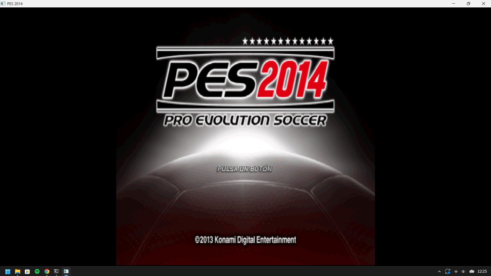
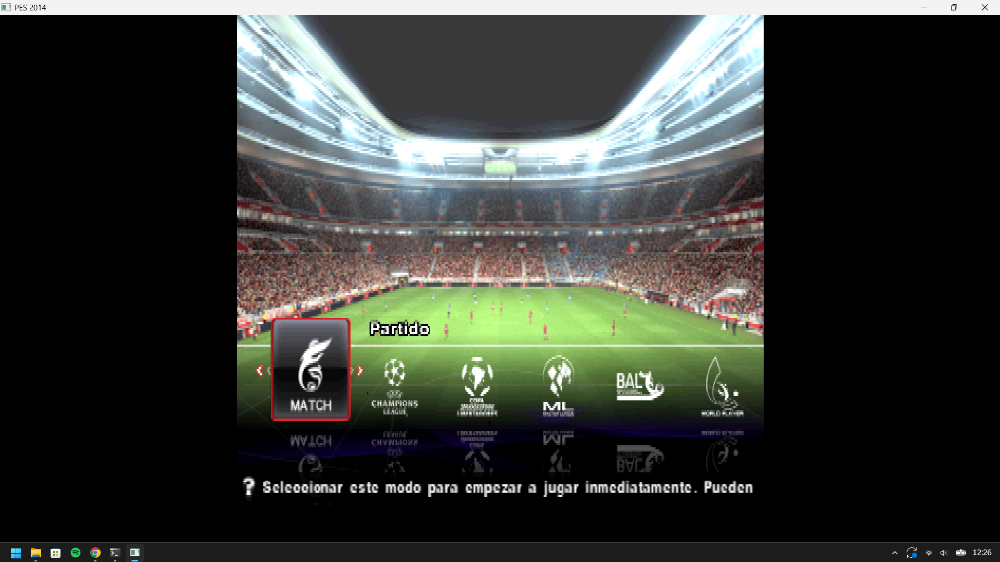
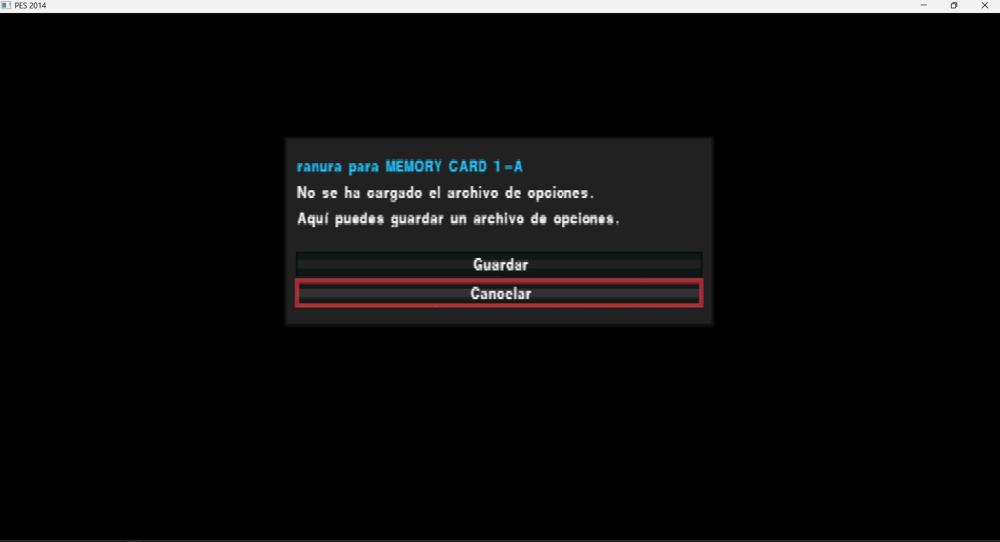

# PES 2014 (PS2) — Recompilação Nativa: Guia Completo (PT-BR)

> Recompilação estática de **Pro Evolution Soccer 2014** (PAL, `SLES_556.76`) para Windows
> x86-64 usando o **PS2Recomp**, mais as correções de runtime necessárias para o jogo rodar e
> renderizar.

**Resumo em uma linha:** o jogo inicia, menus/estádio/torcida/gramado renderizam em cores;
a partida chega ao ponto de carregar `game.ovl` **sem crashar**, mas a cena do jogo ainda sai
preta porque a geometria enviada está degenerada e sem cor.

---

## 1. Estado atual

### ✅ Funciona

| Item | Evidência |
|---|---|
| Boot completo (BIOS → ELF → IOP) | log `[PES boot] thread ...`, `[ps2xIOP] [PES IOP running]` |
| Tela de título, menus, seleção de equipe, escudos/bandeiras | frames PNG com conteúdo real (96–165 KB) |
| Estádio 3D, torcida, gramado, jogadores em campo | idem, com texturas e CLUT corretos |
| Máquina de estados do jogo até a partida | `[PES scene] ... game=10 step=5` |
| Carregamento de overlays | `[PES overlay] bootset/title/select/enter/game/training_free.ovl` |
| Sem `missing-target` | contador = **0** |
| XGKICK saudável | `aborted` caiu de **130 048** para **128** |

### ❌ Ainda não funciona

| Item | Sintoma medido |
|---|---|
| Cena da partida | tela preta (`fbp=128` nunca recebe o blit) |
| Geometria da partida | draws degenerados: `x=0..2048`, `y=2048..2048` (altura/largura zero) |
| Cor da partida | `rgb=0-0/0-0/0-0`, `alpha=0,0` na maioria |
| Framebuffer de cena (`fbp=0`) | uniformemente `0x80` (cinza) — é o *clear*, não a cena |

---

### 📷 Capturas (build nativa, não é emulador)

| Tela de título | Seleção de modo com estádio 3D |
|---|---|
|  |  |

| Caixa de diálogo / cartão de memória |
|---|
|  |

> **Feito com IA.** Tudo o que está descrito aqui — depuração, instrumentação, correções de
> runtime, recompilação de overlays e esta documentação — foi produzido por um **agente de IA**
> (OpenCode com um modelo de linguagem), em sessão interativa com o dono do repositório, que
> executou o jogo, capturou as telas e forneceu o dump de referência do PCSX2.

---

## 2. Arquitetura usada

```
SLES_556.76 (ELF principal)
        │
        ├─ ps2xAnalyzer  (Ghidra + banco de símbolos SCE embutido)
        │        └─ functions.csv  +  analyzer.toml
        │
        ├─ ps2_recomp    (TOML → C++)
        │        ├─ pes2014.toml .......... ELF principal
        │        └─ ranges/overlays/NN.toml ... cada overlay .ovl
        │                 └─ output/ ou code-NN/  (*.cpp, register_functions.cpp)
        │
        ├─ stage-overlays.py  → integra code-NN no runner
        │        └─ ps2xRuntime/src/runner/pes_overlay_*.cpp
        │           ps2xRuntime/src/runner/pes_overlay_dispatch.cpp
        │
        └─ CMake (ps2EntryRunner) → PES2014-Recompiled.exe
```

Componentes de runtime relevantes:

- `ps2xRuntime/src/lib/ps2_vif1_interpreter.cpp` — VIF1 (UNPACK, DIRECT, MPG, MSCAL)
- `ps2xRuntime/src/lib/vu/ps2_vu1_core.cpp` — interpretador VU1 (XGKICK, MSCAL/MSCNT)
- `ps2xRuntime/src/lib/vu/ps2_vu1_lower.cpp` — instruções *lower* do VU1 (LQ/SQ/JR/…)
- `ps2xRuntime/src/lib/gs/ps2_gif_arbiter.cpp` — ordem dos paths GIF
- `ps2xRuntime/src/lib/gs/gs_frontend.cpp` — decodificação de pacotes GIF/GS
- `ps2xRuntime/src/lib/gs/gs_cpu_backend.cpp` — rasterizador GS em CPU
- `ps2xRuntime/src/lib/gs/ps2_gs_memory.cpp` — modelo de memória do GS (swizzle)
- `ps2xRuntime/src/lib/ps2_memory.cpp` — registradores, CSR, DMA, VIF
- `ps2xRuntime/src/lib/Kernel/EeScheduler.cpp` — threads/semáforos/VSync
- `ps2xRuntime/src/runner/pes_overlay_dispatch.cpp` — despacho de overlays

---

## 3. O que foi feito, em ordem

### Fase 1 — Diagnóstico inicial

1. Descobriu-se que a build já gerava um `.exe` funcional (~63 mil funções), mas a cena 3D
   saía preta e só aparecia com `PES2014_FORCE_RGBA=255,255,255,255`.
2. Instrumentou-se o runtime para expor: VU input, SQ/RGBAQ, XGKICK, CLUT/texturas, VRAM,
   draws, fila do disco e estado da máquina de cenas.
3. Capturou-se uma **referência real** de PCSX2 (GS dump) da mesma partida para comparar
   com o runtime.

### Fase 2 — Provas sobre o rendering

- A **CLUT** foi verificada como **correta**: aplicando o mapeamento do runtime à VRAM do dump
  de referência, a paleta resultante é monotônica (`alpha` 01,07,0d,15,1b,21…) — coerente.
  O trace antigo de CLUT era enganoso (pegava os 6 primeiros draws, antes do upload real).
- O **`vf01`** (teto de cor usado por `mini.xyzw vf05, vf05, vf01`) está **correto**:
  `(128,128,128,255)`.
- Desmontando o microprograma VU1 (`vudecode.py`, do Crash-Twinsanity) confirmou-se que o
  slot `RGBAQ` vem de `lq.xyzw vf05, 2(vi04)` → `maxx` → `mini` → `ftoi0` → `sq`.
  Ou seja, **a cor é lida pronta da memória**; não é bug de matemática do VU.

### Fase 3 — Causa raiz nº 1: VIF1 descartava UNPACK (stream x DMA)

Sintoma:

```
[PES VIF trunc] op=6c imm=eaa1 num=70 vl=0 vn=3 ... vuAddr=2a1 bytes=1120 avail=796
```

O interpretador processava **cada bloco DMA isoladamente**. Quando o payload de um UNPACK
atravessava a fronteira de um tag DMA (o VIF é um *stream* de bytes), o unpack inteiro era
silenciosamente descartado — inclusive os registros de vértice e as cores.

Correção (em `ps2_vif1_interpreter.cpp`):

- Buffer persistente `m_vif1Stream` + `m_vif1StreamPos`.
- Ao encontrar comando incompleto, **volta ao início do comando** (`pos = cmdStart`) e
  retoma na próxima chamada, em vez de descartar.
- Mesmo tratamento para `DIRECT/DIRECTHL`, `MPG`, `STMASK`, `STROW`, `STCOL`.
- Compactação do buffer somente a cada 64 KiB (evita custo O(n) por chamada).

Resultado: menus/estádio passaram a renderizar **em cores**; `XGKICK aborted` caiu de
**130 048 → 128**.

### Fase 4 — Causa raiz nº 2: CSR `FINISH` nunca setado

O jogo travava exatamente na transição para a partida, com `draws` congelado.
O thread principal ficava no laço:

```
0x1018EC: ld   r3, 0(0x12001000)   ; GS CSR
0x1018F8: andi r3, r3, 0x2         ; bit 1 = FINISH
0x1018FC: bne  r3, r0, 0x101938    ; espera FINISH
```

Nosso backend GS é **síncrono** (renderiza na hora), então o GS está sempre “finished”,
mas o bit nunca era levantado nas leituras.

Correção (em `ps2_memory.cpp`): leituras do CSR fazem OR com `kGsCsrFinishBit` (bit 1).
O EE continua podendo limpar via escrita *write-1-to-clear*.

Resultado: o jogo passou a avançar para `game=10` (partida).

### Fase 5 — Recompilação dos overlays (feita nesta sessão)

O log mostrou que, no instante da falha, o overlay residente em `0x93A880` era
**`training_free.ovl`**, e esse overlay **não tinha sido recompilado**:

```
[PES overlay] 0x93a880 resident=training_free.ovl bytes=27bdfff0 ffbf0000 c097a08 0
              pc=0x966e20
```

Passos executados:

1. Compilou-se o recompilador: target CMake **`ps2_recomp`** →
   `ps2-build/ps2xRecomp/Release/ps2_recomp.exe`.
2. `ranges/recompile-overlays.py ... 34` → `training_free.ovl`:
   **244 funções**, 569 entry points iniciais.
3. **Melhoria no pipeline:** o script só colhia referências do ELF principal + do próprio
   overlay, perdendo chamadas **entre overlays** (ex.: `select.ovl → training_free.ovl`).
   Passamos a varrer **todos** os `*.ovl.elf`:
   - entry points: **569 → 4.025**
   - `0x959A70` (alvo que faltava) passou a existir na tabela de dispatch.
4. `ranges/stage-overlays.py` regenerou o dispatcher e os batches do runner.
5. Reconfigurou-se o CMake (o build usa *glob* de fontes) e rebuildou-se.

Resultado: **`missing-target` = 0**, jogo não morre mais na transição.

### Fase 6 — O que sobrou

Mesmo sem crash, a partida sai **preta**: as draws da cena são degeneradas e sem cor
(`x=0..2048`, `y=2048..2048`, `rgb=0-0`). É o próximo alvo (ver §9).

---

## 4. Bugs de runtime corrigidos nesta jornada

| # | Arquivo | Sintoma | Correção |
|---|---|---|---|
| 1 | `ps2_vif1_interpreter.cpp` | UNPACK cortado entre tags DMA era descartado | consumo em **stream** com retrocesso ao comando |
| 2 | `ps2_memory.cpp` | CSR `FINISH` nunca setado → laço infinito | leitura do CSR faz OR com bit 1 |
| 3 | `vu/ps2_vu1_lower.cpp` | `JR/JALR` usavam backup antigo de VI (upstream PR #418) | JR/JALR leem **VI atual**; backup só em branch condicional |
| 4 | `gs/ps2_gif_arbiter.cpp` | comparador com UB reordenava Path1 antes de Path3 | drenagem em **FIFO** |
| 5 | `vu/ps2_vu1_core.cpp` | arredondamento do host não restaurado antes do GS (PR #422) | restaura modo de arredondamento ao redor do submit |
| 6 | `ps2_vif1_interpreter.cpp` | `MPG` sem *wrap* de endereço (PR #437) | `uploadMicroMemory` com wrap |
| 7 | `vu/ps2_vu1_core.cpp` | XGKICK inválido matava a VU | cancela só a transferência; pacote limitado a 16 KB |
| 8 | `vu/ps2_vu1_core.cpp` | `MSCNT` reiniciava em endereço errado | retoma no endereço latched pelo MSCAL |
| 9 | `ps2_vif1_interpreter.cpp` | `STMASK` consumia 4 bytes (desalinhava 12) | consome **1 qword** |

---

## 5. Overlays: como funcionam e por que importam

Vários overlays do jogo compartilham a **mesma base de carga** (`0x93A880`):

| # | Arquivo | Extensão real (ELF) |
|---|---|---|
| 29 | `enter.ovl` | 0x93A880–0x97AE80 |
| 30 | `title.ovl` | 0x93A880–0x947A80 |
| 31 | `bootset.ovl` | 0x93A880–0x940480 |
| 32 | `result.ovl` | 0x93A880–0x99C900 |
| 33 | `ending.ovl` | 0x93A880–0x94EA80 |
| 34 | `training_free.ovl` | 0x93A880–0x972E80 |
| 35 | `mc_conv.ovl` | 0x93A880–0x93F500 |
| 36 | `fantasista2.ovl` | 0x93A880–0x98FD80 |

Como o jogo troca de overlay em tempo de execução, o runtime identifica **qual está
residente** por uma *fingerprint* de 16 bytes em `base + 0x80` e só despacha se bater.

> ⚠️ Consequência prática: um endereço como `0x966E20` pertence a **enter** e a
> **training_free** ao mesmo tempo. A fingerprint é o que decide. Foi exatamente isso que
> revelou o overlay que faltava.

### Cobertura de recompilação (medida)

| Overlay | Não recompilado (aproximado) |
|---|---|
| `41 defaultdataset` | 99,4 % |
| `21 fantasista_work` | 97,9 % |
| `40 select` | 57,6 % |
| `18 select1` | 26,5 % |
| `31 bootset` | 22,6 % |
| `19 formation` | 15,0 % |
| `29 enter` | 14,2 % |
| `16 memorycard` | 12,3 % |
| `30 title` | 7,9 % |
| `20 league_prog` | 7,8 % |
| `37 game` | 6,5 % (~250 KB) |

> Parte desses “buracos” é **dado/BSS**, não código. Para decidir, compare a extensão do
> *entry point* máximo com o fim do segmento de código no ELF.

---

## 6. Como compilar

Pré-requisitos: Windows, Visual Studio 2022 (MSVC x64), CMake ≥ 3.25, Python 3, Ninja/MSBuild.

> **Antes de tudo**, rode o verificador de ambiente do pacote de compartilhamento:
> `powershell -ExecutionPolicy Bypass -File .\CHECK.ps1`
> Ele valida toolchain, layout do `disc/`, commit do repositório e espaço em disco (somente
> leitura; sai com código 0 quando está tudo pronto). Detalhes em `share/SETUP.md`.

```powershell
# 1) configurar
$src = "<repo>\.local\PS2Recomp"
$bld = "<repo>\.local\ps2-build"
$gen = "<repo>\.local\pes2014\ranges\output"
cmake -S $src -B $bld "-DPES2014_GENERATED_DIR=$gen" -DFETCHCONTENT_UPDATES_DISCONNECTED=ON

# 2) build do runner (exe final)
cmake --build $bld --config Release --target ps2EntryRunner --parallel 4
#    saída: $bld\ps2xRuntime\Release\PES2014-Recompiled.exe

# 3) (opcional) recompilador, se for regerar código
cmake --build $bld --config Release --target ps2_recomp --parallel 4
```

> **Atenção:** o CMake usa *glob* dos fontes do runner. Depois de gerar/remover arquivos
> `pes_overlay_*.cpp`, é obrigatório **reconfigurar** (`cmake -S ... -B ...`) antes de
> buildar, senão símbolos ficam sem definição (erros `LNK2001`).

## 7. Como rodar

```powershell
# a partir da pasta com o exe + DLLs (dist) e a pasta disc\
$env:PES2014_BOOT_DIAGNOSTICS = '1'   # habilita quase todos os traces
$env:PES2014_TEST_INPUT       = '1'   # navegação automática (Start/Cross alternados)
& ".\PES2014-Recompiled.exe"
```

O exe precisa da pasta `disc\` ao lado (ou de `--elf`/caminho configurado), contendo
`SLES_556.76`, `SYSTEM.CNF`, `IOP\`, e os `*.AFS`.

---

## 8. Variáveis de ambiente de diagnóstico

| Variável | Efeito |
|---|---|
| `PES2014_BOOT_DIAGNOSTICS` | **pré-requisito** da maioria dos traces; dump periódico de threads/semáforos/VRAM/draws |
| `PES2014_TEST_INPUT` | input automático (Start/Cross a cada ~90 frames) |
| `PES2014_TEST_FAST_INPUT` | idem, período 34 |
| `PES2014_GS_FRAME=n` | dump detalhado das draws do frame `n` |
| `PES2014_GS_FRAME_SPAN=k` | janela de `k` frames a partir de `n` |
| `PES2014_TEX_DUMP` | imprime parâmetros de textura/CLUT |
| `PES2014_DUMP_VRAM` | grava `boot-vram-<frame>.bin` (4 MiB) |
| `PES2014_VU_INPUT` | dump dos VIs e memória lida no XGKICK |
| `PES2014_VU_PATH` | trace de caminho/entrada da VU1 |
| `PES2014_SQ_TRACE` | trace dos `SQ` que escrevem RGBAQ |
| `PES2014_DUMP_VU` | grava `vu-code.bin` / `vu-data-*.bin` |
| `PES2014_VU_LOWTRACE` | UNPACKs que caem em endereços baixos |
| `PES2014_XGKICK_TRACE` | trace dos XGKICK emitidos |
| `PES2014_GIF_PATH` | trace por path GIF |
| `PES2014_FORCE_RGBA=r,g,b,a` | força cor de vértice no GS (prova de pipeline) |
| `PES2014_FORCE_ALPHA=a` | força alpha |
| `PES2014_VU_COLOR_FALLBACK` | substitui RGB zero por 128 no SQ (workaround) |
| `PES2014_VIF_TRUNC` | loga UNPACKs que chegam incompletos |
| `PES2014_SEMA_TRACE` | trace de semáforos (create/signal/Wait) |
| `PES2014_FILE_TRACE` | trace de arquivos (VFS e IOP host) |

---

## 9. O que ainda falta (o problema aberto)

### Sintoma

Na partida (`game=10`), a tela fica preta. As draws submetidas são degeneradas e sem cor:

```
[PES GS draw] fbp=0 prim=4 iip=1 abe=1 x=0,2048 y=2048,2048
              textured=1 tex=8224 tpsm=20 clut=15936/0/0/0 alpha=0,0 rgb=0-0/0-0/0-0
```

`XYOFFSET = 0x7000` (28672 = 2048 em 12.4): uma posição de `0` vira `2048`. Ou seja, os
vértices estão chegando **zerados** ao VU/GS nesse caminho.

### O que já foi descartado

- CLUT: correta (validada contra o dump do PCSX2).
- `vf01`: correto `(128,128,128,255)`.
- Pipeline GS 2D/blit: funciona (menus renderizam com o mesmo blit `fbp=0 → 128`).
- Overlays: todos os necessários carregam; `missing-target` = 0.

### Hipóteses para investigar

1. **Registros de vértice da partida**: o VU lê `lq.xyzw vf05, 2(vi04)`. Em amostras
   anteriores o `q2` (cor) vinha `0` e `q0` (posição) com floats válidos — mas nas draws
   finais tudo está zerado. Comparar o **UNPACK que escreve `vi04..vi04+3`** com o que o VU
   lê no mesmo instante (usar `PES2014_VU_LOWTRACE` + `PES2014_VU_INPUT`).
2. **Duplo-buffer TOPS**: se o produtor escreve em `0x2xx` e o consumidor lê `0x0xx`
   (ou vice-versa), os dados não se encontram.
3. **Segundo caminho VU** (`0x1F0`/`0x3F0`): verificar se o programa que escreve as
   cores (`sq.xyzw vf01, 2(vi04)` / `sq.xyzw vf07, 2(vi01)`) está sendo executado.
4. **Blit final**: confirmar se as sprites `prim=6, tme=1, fb=128` ainda são emitidas na
   partida (não apenas `prim=4` degenerado).

### Como reproduzir

```powershell
$env:PES2014_BOOT_DIAGNOSTICS='1'
$env:PES2014_TEST_INPUT='1'
$env:PES2014_GS_FRAME='9000'
$env:PES2014_VU_INPUT='1'
$env:PES2014_VU_LOWTRACE='1'
$env:PES2014_SQ_TRACE='1'
.\PES2014-Recompiled.exe
: > boot-frame-9000.png  # comparar com o frame do PCSX2
```

---

## 10. Dados de referência (PCSX2)

- Dump capturado: `Pro Evolution Soccer 2014_SLES-55676_20261111200920.gs.zst` (2 MB)
- Descomprimido: 11 169 623 bytes; 1 636 transferências (todas `path=3`); `state_version=9`.
- Formato do dump: `[0xFFFFFFFF][header][state][regs 0x2000][id 0/1/2/3 ...]`.
- Pacote de cena de referência `tag=3000000000008004` (NLOOP=4, NREG=3, ST/RGBAQ/XYZF2):

```
RGBAQ  r=128 g=124 b=128 a=128
ST     s≈0.0030 t=0.0000 q≈0.0015
XYZF2  x=44165 y=12437 z=0x12c4 f=250
```

- CLUT de referência em `cbp=16212`: `3cffffff 47ffffff 3c777777 478d8d8d 51ffffff …`
  (alpha crescente — paleta válida).
- `TEX0_1` de referência: `tbp=15200 tbw=2 psm=19 cbp=16312 cpsm=0 csm=0 csa=1`.

---

## 11. Ferramentas e scripts do projeto

| Caminho | Função |
|---|---|
| `ranges/export-overlays.py` | extrai os `.ovl` do AFS e gera ELFs + `overlays.json` |
| `ranges/recompile-overlays.py` | gera `NN.toml` (entry points automáticos) e roda o recompilador |
| `ranges/stage-overlays.py` | integra `code-NN` ao runner e regenera o dispatcher |
| `ranges/collect-overlay-imports.py` | coleta imports/relocações |
| `ranges/test-boot.ps1` | roda o jogo por N segundos e salva logs/PNGs |
| `ranges/rebuild-test.ps1` | build + smoke test |
| `build-prototype.ps1` | batches + CMake + build |
| `tools/` | capstone, pyelftools (análise) |

---

## 12. Como ajudar

1. **Reproduza** o estado atual com os comandos acima e confirme os números
   (`missing-target=0`, `XGKICK aborted≈128`).
2. **Atace o problema aberto** (§9). O ponto mais eficiente hoje é comparar,
   frame a frame, os pacotes que o nosso VU1 produz com os do dump do PCSX2.
3. **Envie referências**: se você tiver PCSX2 + BIOS, um GS dump dos **primeiros segundos
   da partida** (apito inicial, câmera de jogo) vale ouro.
4. **Recompile overlays faltantes** usando o pipeline da §11 (o `recompile-overlays.py` já
   foi melhorado para varrer todos os overlays).

---

## Apêndice — números da sessão

| Métrica | Antes | Depois |
|---|---|---|
| `missing-target` | 1 (thread morria em `pc=0x1`) | **0** |
| `XGKICK aborted` | 130 048 | **128** |
| `draws` (frame 8640) | congelado em 417 051 | 409 071+ (sem crash) |
| Overlays recompilados | 12 | **13** (+`training_free`) |
| Entry points de `training_free` | — | 4 025 |
| Funções de `training_free` | — | 244 |
